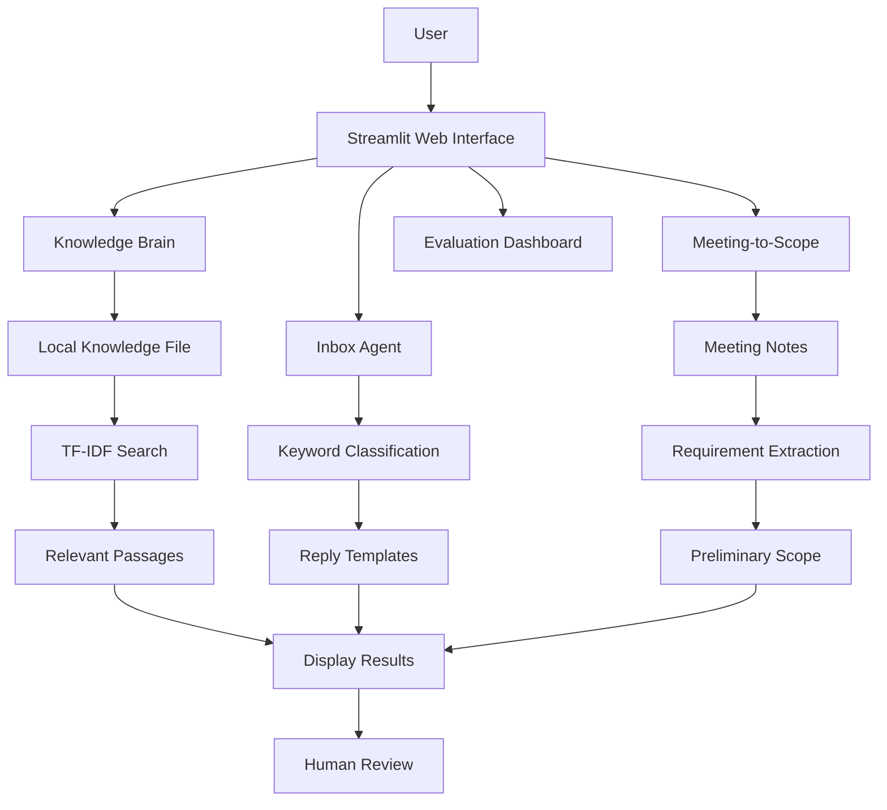
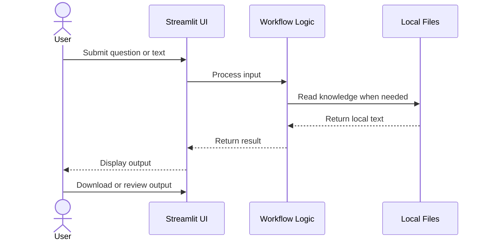

# 🏗️ AI Tech Consultant — System Design

> **Project:** AI Tech Consultant  
> **Architecture:** Modular, local-first web application  
> **Language:** Python  
> **Interface:** Streamlit  
> **AI API:** Not required for the current prototype

---

## 📌 1. System Overview

AI Tech Consultant is a prototype that combines three business workflows in one web interface:

- 📚 **Knowledge Brain:** Searches local support documentation.
- 📧 **Inbox Agent:** Classifies emails and drafts suggested replies.
- 📝 **Meeting-to-Scope:** Extracts preliminary project requirements from meeting notes.
- 🧪 **Evaluation Dashboard:** Runs basic functional checks.

The application prioritizes simple setup, transparent processing, and human review.

---

## 🧩 2. System Architecture



**Diagram note:** This describes the current prototype. It does not represent a deployed multi-agent AI system.

---

## ⚙️ 3. Component Design

### 📚 3.1 Knowledge Brain

**Purpose:** Retrieve relevant information from a local knowledge base.

**Processing flow:**

1. Load text from `data/knowledge.txt`.
2. Split the content into paragraphs.
3. Convert paragraphs and the user's question into TF-IDF vectors.
4. Calculate cosine similarity.
5. Display the highest-ranked matching passages.

**Input:** A user question.

**Output:** Relevant text passages and the source filename.

**Current limitation:** TF-IDF is a text retrieval technique, not a generative AI model. External documentation crawling and semantic embeddings are not implemented.

### 📧 3.2 Inbox Agent

**Purpose:** Help support staff categorize incoming customer emails and prepare replies.

**Processing flow:**

1. Accept an email from the user.
2. Check for predefined keywords.
3. Assign a category: Technical Support, Billing, or General Inquiry.
4. Select a matching reply template.
5. Display the draft for human review.
6. Allow the reply to be downloaded.

**Safety control:** The application does not automatically send emails.

### 📝 3.3 Meeting-to-Scope

**Purpose:** Convert meeting notes into a preliminary requirements list.

**Processing flow:**

1. Accept meeting notes or a transcript.
2. Extract non-empty lines.
3. Display the extracted requirements.
4. Suggest next steps for feasibility and estimation.
5. Offer a downloadable scope document.

**Current limitation:** The prototype does not yet perform semantic meeting analysis, validate product feasibility, or calculate reliable estimates.

### 🧪 3.4 Evaluation Dashboard

**Purpose:** Check whether selected core functions operate.

It includes basic checks for:

- Knowledge file availability.
- Sample knowledge retrieval.
- Example email keyword classification.
- Basic meeting-note extraction.

These checks do not establish overall AI answer quality or production readiness.

---

## 🔄 4. Data Flow



The current implementation processes user inputs locally. It does not require an external AI service.

---

## 🛠️ 5. Technology Stack

| Technology | Responsibility |
|---|---|
| Python | Core application logic |
| Streamlit | Web interface |
| scikit-learn | TF-IDF vectorization and similarity |
| pathlib | File access |
| Markdown | Project documentation |

---

## 📂 6. Project Structure

```text
ai-tech-consultant/
│
├── app.py
├── README.md
├── DESIGN.md
├── EVALS.md
├── AI_LOG.md
│
├── data/
│   └── knowledge.txt
│
└── venv/
```

The `venv/` folder contains the local Python environment and should not be committed to GitHub.

---

## 🔐 7. Security and Human Oversight

- Do not store passwords or private customer information in sample files.
- Do not commit secrets or API keys to source control.
- Require human review before sending replies or sharing project scopes.
- Verify requirements and estimates before making business commitments.
- Add authentication and access controls before introducing sensitive business data.

---

## 🚀 8. Planned Architecture Improvements

| Area | Planned improvement |
|---|---|
| Knowledge Brain | Crawl approved support documentation and process sitemaps |
| Retrieval | Add chunking, embeddings, and vector search |
| Answer generation | Add grounded RAG with verifiable citations |
| Inbox Agent | Integrate an email provider with approval controls |
| Meeting-to-Scope | Add structured extraction and feasibility validation |
| Evaluation | Test at least 20 representative cases per workflow |
| Monitoring | Record quality, latency, and costs for optional model integrations |

These are planned enhancements, not completed features.

---

## 🎯 9. Design Principles

1. **Modularity:** Keep the workflows logically separated.
2. **Transparency:** Show the basis of retrieved information where available.
3. **Human oversight:** Require review before external actions.
4. **Privacy:** Prefer local processing for the current prototype.
5. **Testability:** Verify expected behavior using documented test cases.
6. **Extensibility:** Design the prototype so stronger retrieval and AI integrations can be added later.

---

## ✅ 10. Conclusion

AI Tech Consultant provides a foundation for exploring knowledge retrieval, email assistance, and requirements extraction in a single Python application.

The current version is a local, rules-based prototype. Additional development and evaluation are required before it can be described as a complete AI-powered, multi-agent business automation system.
